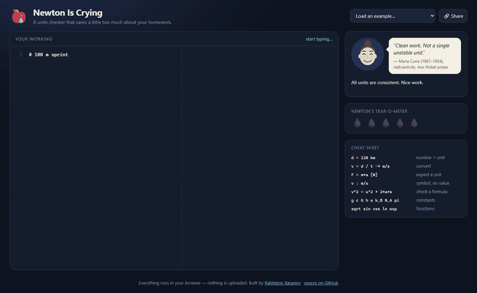
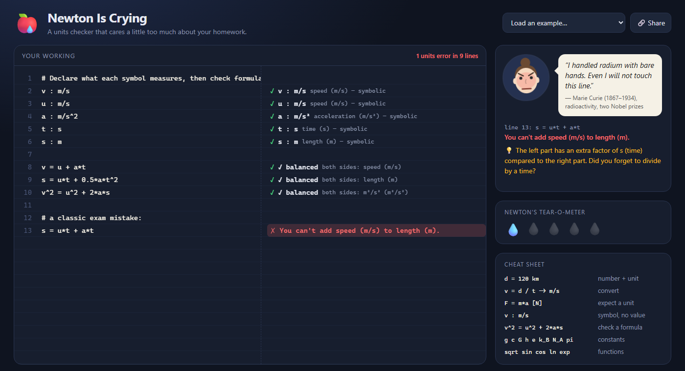

# 🍎💧 Newton Is Crying

**A units checker that cares a little too much about your homework.**

Type your physics working line by line, like on paper. Newton Is Crying runs
**dimensional analysis** on every line, catches the exact place where the units
stop making sense, tells you *what factor is missing*, and lets a famous
scientist react to your mistake.

[](https://github.com/GGmanforeal/newton-is-crying/actions/workflows/ci.yml)


**▶ Live demo:** https://ggmanforeal.github.io/newton-is-crying/



---

## Why

Unit mistakes are one of the most common ways to lose marks in physics and
chemistry. Examples include adding a distance to a time, forgetting to square a
time, or mixing km/h and m/s. Most calculators can't help, because they only see
numbers, not *kinds of quantity*.

Newton Is Crying treats every value as a number **plus a physical dimension**
and checks each step. It gives the right answer in the right units. When
something is wrong, it says exactly what is wrong:

> **You expected kg·m/s (momentum), but this is force (kg·m/s²).**
> 💡 Your result is missing a factor of s (time) compared to what you expected. Did you forget to multiply by a time?
> *"Insanity is expecting momentum and getting force every single time."* — Albert Einstein

## Features

- **Line-by-line checking**: variables carry over between lines, exactly like working on paper.
- **Real units**: SI base and derived units (N, J, W, Pa, V, Ω…), SI prefixes (km, mA, µs, kWh…), and everyday units (h, min, L, atm, eV, cal, mph…).
- **Unit conversion**: `v = d / t -> km/h`.
- **Expected-unit checks**: `F = m * a [N]` fails loudly if the result isn't a force.
- **Formula checking without numbers**: declare `v : m/s`, `a : m/s^2`, `t : s`, then check whether `s = u*t + 0.5*a*t^2` is dimensionally consistent. Useful for checking a formula you half-remember before an exam.
- **"Missing factor" diagnosis**: compares the two dimension vectors and tells you, for example, that you forgot to multiply by a time.
- **Smart warnings**: `sin(30)` gets a "did you mean 30 deg?" warning. Equations whose units match but whose numbers don't also get flagged.
- **7 scientists with moods**: Newton, Einstein, Curie, Feynman, and three Central Asian scholars: al-Khwarizmi, al-Biruni and Ulugh Beg. They are drawn as procedural SVG portraits (no image files). Each one cries, fumes, or (when everything checks out) looks proud.
- **Newton's tear-o-meter** counts your errors (up to 5 💧).
- **Shareable links**: the whole sheet is encoded in the URL, with no server.
- **Works offline**: the build is a single ~40 KB HTML file. You can open it straight from disk.
- **CLI**: check `.txt` homework files from the terminal. It exits with code 1 on errors, so it can run in CI to check lab reports.



## Syntax in 30 seconds

| You write | Meaning |
|---|---|
| `d = 120 km` | a number with a unit (the word right after a number is a unit) |
| `v = d / t` | use earlier variables |
| `v = d / t -> m/s` | convert the result |
| `F = m * a [N]` | check that the result has the expected unit |
| `v : m/s` | declare a symbol with a unit but no value |
| `v^2 = u^2 + 2*a*s` | check that both sides of a formula have the same dimension |
| `2 pi r` | implicit multiplication |
| `9.8 m/s²`, `3 kg·m·s⁻²` | Unicode superscripts and `·` work |
| `g c G h e k_B N_A R pi` | physical constants (your own variables override them) |
| `sqrt cbrt abs sin cos tan asin acos atan exp ln log10` | functions (trig/log require pure numbers) |
| `# comment` or `// comment` | ignored |

## How it works

```
 "v = d / t^2 [m/s]"
        │
        ▼
 ┌─────────────┐   ┌───────────────────────┐   ┌──────────────────────┐
 │   Lexer     │──▶│ Recursive-descent     │──▶│ Evaluator over       │
 │ (unicode ², │   │ parser (statements,   │   │ dimension vectors    │
 │  ·, ×, →)   │   │ unit-vs-variable      │   │ in ℚ⁷ (m,kg,s,A,K,   │
 └─────────────┘   │ disambiguation)       │   │ mol,cd) + SI values  │
                   └───────────────────────┘   └──────────┬───────────┘
                                                          ▼
                       ┌────────────────────┐   ┌──────────────────────┐
                       │ Roast engine       │◀──│ Diagnostics: ratio   │
                       │ (FNV-1a, stable)   │   │ of dimension vectors │
                       └────────────────────┘   │ → "missing factor"   │
                                                └──────────────────────┘
```

- **Dimensions are vectors.** Every quantity is stored as an SI value plus a vector
  of 7 exponents, e.g. force = `[1, 1, -2, 0, 0, 0, 0]` for kg¹·m¹·s⁻².
  Multiplying quantities adds vectors and raising to a power scales them.
  Adding requires the vectors to be equal. Fractional exponents are allowed, so
  `sqrt(16 m^2)` is exactly `4 m`.
- **The diagnosis is vector subtraction.** When `a + b` fails, the ratio `dim(a) − dim(b)`
  is split into positive and negative parts. That gives the "extra factor"
  and "missing factor" hints.
- **Is `m` a metre or a mass?** It's ambiguous in physics, so the parser uses a
  small set of rules:
  - The word right after a number is always a unit (`3 m` is 3 metres, even if you defined a mass `m`).
  - Later words in the same unit expression are units only if no variable has that name (`10 m / t` uses your variable `t`, not tonnes).
  - `10 kg * g` means standard gravity, while `10 kg*g` (written tight) means kilogram-grams.
- **Deterministic jokes.** The scientist is chosen by an FNV-1a hash of the line, so the same
  mistake always gets the same reaction. That keeps the tests and screenshots stable.

The engine is about 1,200 lines of TypeScript with **zero runtime dependencies**.
I wrote the parser, the units system and the formatter myself instead of using a units library.

## Run it on Windows

You need [Node.js](https://nodejs.org) 18 or newer.

```bash
git clone https://github.com/GGmanforeal/newton-is-crying.git
cd newton-is-crying
npm install
npm run dev          # opens the web app with hot reload
```

Build the offline single-file version and the CLI:

```bash
npm run build        # → dist/index.html (double-click it) and dist-cli/newton.mjs
```

### Command line

```bash
node dist-cli/newton.mjs examples/broken-homework.txt
node dist-cli/newton.mjs -e "3 m + 2 s"
```

```
 14 │ total = d + t                ✗ You can't add time (s) to length (m).
    │                              ↳ They differ by a factor of m/s — these are just different kinds of quantity.
    │                              “I gave you three laws AND calculus, and you add time to length?…” — Isaac Newton
 17 │ p = m * a [kg*m/s]           ✗ You expected kg·m/s (momentum), but this is force (kg·m/s²).
    │                              ↳ Your result is missing a factor of s (time) compared to what you expected.

2 units errors. Newton's tear-o-meter: 💧💧
```

Add `--json` for machine-readable output.

## Tests

```bash
npm test             # 46 tests: units, lexer, parser, evaluator, diagnostics, examples
npm run typecheck
```

Every built-in example is tested to contain exactly the mistakes planted in it.
The physics is tested too: the ISS orbit comes out at ~92 minutes, and a 2 kW
kettle boils 1.5 L in ~4.2 minutes.

## Project structure

```
src/core/      the engine (no DOM): dimension.ts, units.ts, lexer.ts, parser.ts,
               evaluate.ts, format.ts, notebook.ts, roasts.ts
src/web/       the UI: main.ts, avatars.ts (procedural SVG portraits), examples.ts
src/cli.ts     the terminal tool
tests/         Vitest suites
examples/      sample homework sheets
```

## Limitations (honest section)

- Dimensional analysis can't catch a wrong *number*: `s = u*t + a*t^2` is
  dimensionally fine but is missing the ½. Units are a necessary check, not a sufficient one.
- Temperatures are absolute (K) only. °C/°F need offsets, which this model doesn't do yet.
- Angles are treated as pure numbers, as in SI. `deg` and `rad` are just conversion factors.

## Credits

The quotes are **made-up jokes** written for this app, not real quotations. The
real scientists' work is far more impressive than anyone's homework. Al-Khwarizmi
(Khwarazm), al-Biruni (Khwarazm) and Ulugh Beg (Samarkand) are included as a nod
to the scientific history of Uzbekistan.

Made by **Rahimjon Xasanov** ([@GGmanforeal](https://github.com/GGmanforeal)).
MIT licensed. See [LICENSE](LICENSE).
